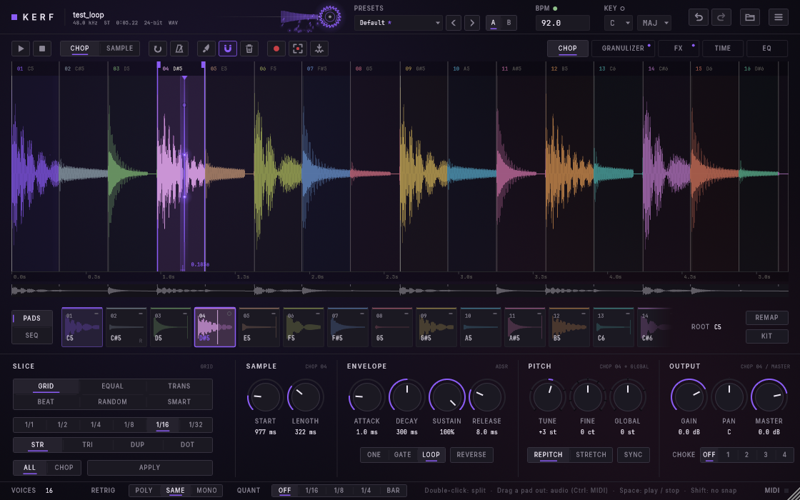

# KERF

**Chop it. Play it. Bend it.**

KERF is a sample chopper, granular instrument and effects box in one plugin. Drop in a
sample, cut it into chops, play them from pads or your keyboard, build a beat in the step
sequencer, and push the sound somewhere new with the granulizer, tape-style TIME curves,
effects and an EQ.

> **Version 1.1.0.** If something breaks or feels off, please tell me (see *Feedback* below).

---

## Thanks for downloading!

Thanks for giving KERF a try. I hope it sparks a few ideas.

## Installing

Download the latest version from the **Releases** page on the right.

### Windows (64-bit)

1. Download **KERF-...-Windows-Setup.exe** and run it.
2. Windows may say *"Windows protected your PC"*, because KERF is not signed.
   Click **More info → Run anyway**.
3. In your DAW, rescan your plugins. In FL Studio, go to **Options → Manage plugins →
   Find installed plugins**, then add **KERF** from *Generators*.

The installer puts the VST3 plugin where every DAW looks for it, adds the standalone app
(it runs without a DAW) and an uninstaller.

### macOS (Apple Silicon and Intel, macOS 11 or newer)

1. Download **KERF-...-macOS-Installer.pkg** and double-click it.
2. macOS may say it *"cannot verify the developer"*, because KERF is not signed by
   Apple. Open **System Settings → Privacy & Security**, scroll down and click
   **Open Anyway** next to the KERF message. Then open the installer again.
3. Click through the installer, then restart your DAW. KERF comes as **VST3** (Ableton,
   FL Studio, Reaper, Bitwig ...), **AU** (Logic, GarageBand) and a standalone app.

Prefer plain files? Each release also has a zip with the plugin files and short
instructions.

## First steps

1. **Drop a sample** onto the big waveform. KERF finds its tempo and key by itself (and reads
   them from the file name when a sample pack puts them there).
2. **Slice it**: pick GRID, BEAT, TRANS or another mode and press **APPLY**. Silent stretches
   are left out, so every chop starts right on its sound.
3. **Play** the pads with the mouse or your MIDI keyboard. Each chop sits on its own key.
4. Switch to **SEQ** and click steps to build a pattern, or roll the die for one.
5. Open **GRANULIZER**, **FX**, **TIME** and **EQ**, try one of the 77 presets, or press
   **Random** in the preset menu for a new sound every click.

The built-in guide shows you around on first start. Open it again any time from the
menu, top right. Every shortcut and detail is in the [manual](docs/MANUAL.md).

## Feedback

Found a bug or have an idea? Open an issue here on GitHub. A screenshot and what you did
just before it happened help a lot.

## Credits

Created and designed by **Julien Upmeier**.

KERF uses JUCE, Signalsmith Stretch, and the Inter and JetBrains Mono fonts. Their
licences are in KERF's About page and in [docs/DEPENDENCIES.md](docs/DEPENDENCIES.md).

